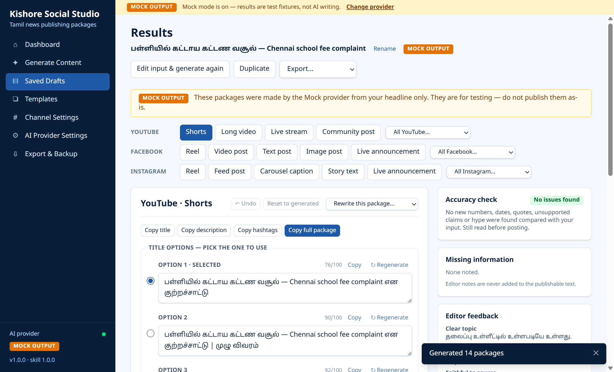
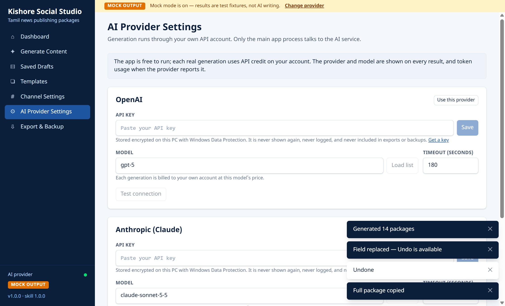
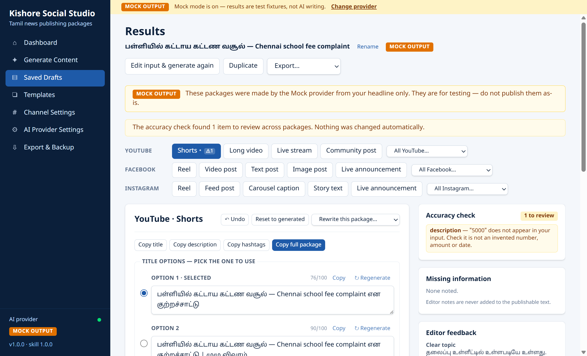

<h1 align="center">📰 Kishore Social Studio</h1>

<p align="center"><b>AI-powered Windows app that turns a Tamil news headline into accuracy-checked publishing packages for YouTube, Facebook & Instagram.</b></p>

<p align="center">
       
</p>

<p align="center">
  
  
  
</p>

## ✨ Highlights

- **14 content types** across YouTube, Facebook and Instagram from a single headline
- **Accuracy guard in code** — never invents names, numbers, dates or quotes; allegations stay allegations
- **Bring your own AI** — OpenAI or Anthropic, plus an offline Mock provider
- **Security-first Electron** — sandboxed renderer, zod-validated IPC, DPAPI-encrypted API keys
- **80+ automated tests** (Vitest unit/integration + Playwright end-to-end)

---
A Windows 11 desktop app that turns a Tamil news headline (plus optional summary,
facts, allegations, transcript or source text) into separate, editable publishing
packages for **YouTube, Facebook and Instagram**, 14 content types in all.

Everything runs locally. The only network traffic is the AI call itself, made by
the app's main process to OpenAI or Anthropic with **your own API key**. A
clearly labelled **Mock** provider lets you use the whole app without any key.

The defining rule is **accuracy**: the app never adds names, numbers, dates or
quotes that are not in your input, and never turns an allegation or a question
into a confirmed fact. That rule is enforced twice: in the prompt (`skills/social-content/SKILL.md`),
and again **in code** after every generation, regeneration and edit
(`src/shared/guards/accuracy.ts`). Problems are shown as warnings beside the
field. Nothing is silently rewritten.

---

## Install the app (for everyday use)

1. Run `Kishore-Social-Studio-Setup-1.0.0.exe` (it is in `dist/` after a build).
2. Windows SmartScreen will say *"Windows protected your PC"*, because the installer
   is not code-signed. Click **More info → Run anyway**.
3. The installer is per-user, so no administrator rights are needed. You can choose the folder.
4. Open **Kishore Social Studio** from the Start menu or the desktop.

The app starts in **Mock mode**. To use real AI:
**AI Provider Settings → OpenAI or Anthropic → paste API key → Save → Test connection → Use this provider.**

## Build it yourself (developers)

Requirements: Windows 11 x64, **Node.js 22.12 or newer** (built and tested with Node 26.8.2 / npm 11.19.1), and an internet connection for `npm install`.

```powershell
cd kishoresocial
npm install            # also downloads the Electron runtime (postinstall)
npm run dev            # run the app with hot reload
npm test               # 80 unit/integration tests (Vitest)
npm run test:e2e       # builds, then drives the real Electron window (Playwright)
npm run dist           # typecheck + tests + build + Windows installer → dist\
```

`npm run dist` produces:

| File | What it is |
|---|---|
| `dist\Kishore-Social-Studio-Setup-1.0.0.exe` | NSIS installer, x64, per-user (~109 MB) |
| `dist\win-unpacked\KishoreSocialStudio.exe` | The app without installing (portable test) |

To run the E2E test against the packaged app instead of the dev build:

```powershell
npm run dist:dir
$env:KSS_E2E_EXE = "dist/win-unpacked/KishoreSocialStudio.exe"; npx playwright test
```

Other scripts: `npm run typecheck`, `npm run build` (bundles only), `npm run make-icon` (regenerates `build/icon.png` / `icon.ico`).

## Where your data lives

| What | Where |
|---|---|
| Drafts, packages, edit history, profiles, templates, settings | `%APPDATA%\Kishore Social Studio\kishore-social-studio.db` (SQLite) |
| API keys (encrypted with Windows DPAPI via Electron `safeStorage`) | `%APPDATA%\Kishore Social Studio\secrets\*.key` |
| Log file (keys and auth headers are redacted before writing) | `%APPDATA%\Kishore Social Studio\logs\app.log` |

Uninstalling keeps this folder. Delete it by hand to remove all data.
**Export & Backup → Create backup** saves everything except API keys to one JSON file.

## Using the app

1. **Generate Content.** Type the headline. Optionally open *Context, facts, allegations…*:
   - **Confirmed facts** may be stated plainly.
   - **Allegations / claims** are always worded as allegations, e.g. "…என குற்றச்சாட்டு".
   - **Source URL** is stored as a reference only, with a **NOT READ** badge. Paste the article text into *Source text* to use it.
   - Tick *official / exclusive / breaking / full speech* only if true. Otherwise those words are flagged.
   - **Live event**: the status (upcoming / live / ended) controls whether "LIVE" may be used.
   - Pick content types, language (Tamil / English / mix), tone, emojis, hashtags and channel profile.
2. **Results.** There is one tab per content type, and each field can be edited (it saves when you click outside the box).
   - Counters show platform limits. Red means a hard platform limit and blocks **Copy full package**; amber means our preferred length.
   - **↻ Regenerate** on a field offers *New wording* or a quick action (*Shorter, More professional, More engaging, Simpler Tamil, Fewer emojis, No emojis*). You see a word-level **diff** and accept or keep the current text. Only that field changes.
   - **Undo** walks back edits and regenerations one step at a time. **Reset to generated** restores the original AI output (also undoable).
   - *Rewrite this package…* and *All YouTube/Facebook/Instagram…* regenerate whole packages or a whole platform.
   - The side panel shows **accuracy warnings** (click one to jump to the field), **missing information**, sources used and editor feedback. These notes are never put into publishable text.
3. **Saved Drafts.** Search, filter by platform and date, rename, duplicate, delete with **Undo** (deleted drafts are purged after 30 days).
4. **Templates.** Save Generate-screen presets and apply them later.
5. **Channel Settings.** Edit channel profiles and mandatory hashtags (defaults below), default language and tone, timezone, and the editable list of hype phrases the accuracy check flags.
6. **Export & Backup.** Export a draft as TXT / JSON / printable HTML / PDF (from Results), export several drafts to CSV, create a full backup, or import one (you see a preview first, and importing only adds data).

Default branding (editable):

| Platform | Account | Mandatory hashtag |
|---|---|---|
| YouTube | growwithkishore | #growwithkishore |
| Facebook | growwithkishorenews | #growwithkishorenews |
| Instagram | growwithkishorenews | #growwithkishorenews |

## Cost

The app is free to run. Each real generation uses API credit on your own OpenAI or
Anthropic account. Every result shows the provider and model, plus token usage
when the provider reports it. There is at most **one** automatic repair retry when
the AI's answer does not match the required format, and no other automatic retry loops.

## Project layout

```
skills/social-content/   SKILL.md (prompt + accuracy rules), platform-rules.json (limits + guidance), examples.json
src/main/                Electron main process: window security, IPC handlers, SQLite, AI pipeline,
                         provider adapters (openai / anthropic / mock), secrets, export/backup, logger
src/preload/             The only bridge: window.api.invoke(channel, payload)
src/renderer/            React + Tailwind UI (8 screens), bundled Noto Sans Tamil font
src/shared/              zod schemas, IPC contract, accuracy + branding guards, limits, text formatting
tests/unit/              Vitest: guards, schema, branding, IPC flow, security, persistence, provider adapters
tests/e2e/               Playwright: drives the real Electron window
docs/                    DECISIONS, PLATFORM-LIMITS, TROUBLESHOOTING, TEST-REPORT, samples/
```

## Security summary

- `contextIsolation`, `sandbox` and no Node integration in the page. The preload exposes one function, `invoke`, never `ipcRenderer`.
- Every IPC payload is validated with zod in the main process, and calls are accepted only from the app's own top-level page.
- Strict Content Security Policy in production. The renderer cannot make network requests (blocked at the session level) and cannot navigate or open windows. External links open in your browser only for an allowlisted set of https sites.
- AI text is shown only in inputs and text areas, never as HTML.
- API keys are encrypted with Windows DPAPI and never stored in SQLite, logs, exports or backups (covered by tests). The UI only ever sees "saved: yes/no" and the last 4 characters.
- CSV cells starting with `= + - @`, tab or CR get an apostrophe prefix so spreadsheets can't run them as formulas.
- Source text is wrapped in delimited data blocks; delimiter look-alikes inside your text are neutralised; the skill tells the model to treat block contents as data.
- The skill is read only from the bundled `skills/` folder, at fixed, path-checked file names.

See `docs/DECISIONS.md` for what was chosen and why, and `docs/TEST-REPORT.md` for exactly what was and was not verified.


---

## 👨‍💻 Author

**Kishore** — B.Tech Computer Science · Software developer building practical apps for everyday problems in Tamil Nadu and India.

- GitHub: [@joker7866](https://github.com/joker7866)

<p align="center"><sub>⭐ If you find this project useful, consider giving it a star!</sub></p>
